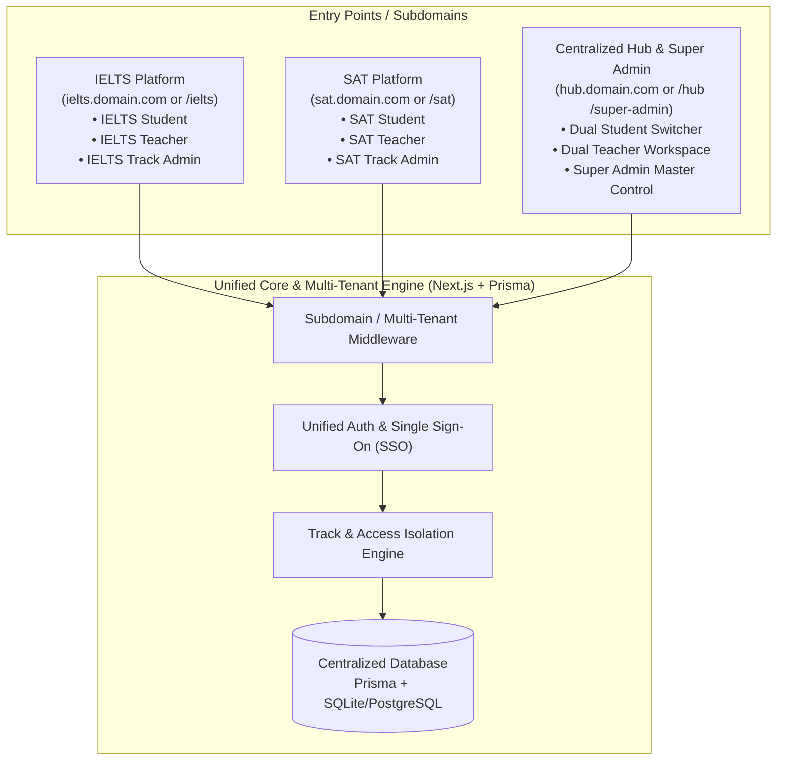

# Implementation Plan: Dual IELTS & SAT Educational Platform

## Goal Description
Build a comprehensive, modern educational platform tailored for two distinct standardized test preparation tracks: **IELTS** and **SAT**. 

The system provides dedicated preparation environments for each test type while offering unified management through a 4-tier panel architecture:
1. **Student Panel**: Dedicated IELTS mode, dedicated SAT mode, or Dual (both) mode with seamless switching and unified analytics.
2. **Teacher Panel**: Dedicated IELTS teacher, dedicated SAT teacher, or Dual teacher workspace to upload study materials (audio, PDF, video), build question sets, and grade mock tests (e.g. IELTS Writing/Speaking rubrics and SAT Math/Reading explanations).
3. **Track Admin Panel**: Platform-specific administration for IELTS or SAT to manage domain curricula, content approvals, teacher assignments, and track-level student cohorts.
4. **Super Admin Panel**: Master control center overseeing both platforms, global user access, subscription tiers, analytics, system configurations, and audit logs.

---

## Architecture & System Design



### Entry Points & Multi-Tenant Routing
The platform is designed with **subdomain / multi-entry point routing** managed via Next.js Middleware:
1. **IELTS Subdomain / Entry Point** (`ielts.domain.com` or `/ielts`):
   - Dedicated IELTS theme, branding, and navigation.
   - **IELTS Student Panel**: 4 modules (Listening, Reading, Writing, Speaking), band score tracking, IELTS mock test simulator.
   - **IELTS Teacher Panel**: IELTS study materials (audio tracks, reading passages), essay grading rubrics (Task 1 & 2), speaking evaluation.
   - **IELTS Track Admin Panel**: IELTS course management, teacher assignment, test scheduling.
2. **SAT Subdomain / Entry Point** (`sat.domain.com` or `/sat`):
   - Dedicated SAT theme (College Board / Digital SAT look & feel).
   - **SAT Student Panel**: Reading & Writing + Math sections, 400-1600 scoring, timed Digital SAT exam simulator with built-in calculator & reference formulas.
   - **SAT Teacher Panel**: SAT question bank builder, math explanation tools, assignment tracking.
   - **SAT Track Admin Panel**: SAT curriculum management, mock test releases, performance analytics.
3. **Central Hub & Super Admin** (`hub.domain.com` or `/hub` & `/super-admin`):
   - **Dual Student & Teacher Switchboard**: Seamless single-sign-on access allowing dual-enrolled students and teachers to switch between IELTS and SAT with one click without logging out.
   - **Super Admin Panel**: System-wide oversight, cross-platform metrics, user permissions (assigning roles: IELTS only, SAT only, or Both), subscription tiers, and audit logs.

### Role-Based Access Control (RBAC) Matrix

| Panel / Role | IELTS Content | SAT Content | Material Upload | Grading & Reviews | User Management | Global Settings |
| :--- | :--- | :--- | :--- | :--- | :--- | :--- |
| **IELTS Student** | Full Access | ❌ Locked / Upgrade | ❌ | Self Results | ❌ | ❌ |
| **SAT Student** | ❌ Locked / Upgrade | Full Access | ❌ | Self Results | ❌ | ❌ |
| **Dual Student** | Full Access | Full Access | ❌ | Self Results | ❌ | ❌ |
| **IELTS Teacher** | Manage & View | ❌ Locked | IELTS Audio, PDF, Tests | IELTS Writing/Speaking | ❌ | ❌ |
| **SAT Teacher** | ❌ Locked | Manage & View | SAT Math, RW, Tests | SAT Question Bank | ❌ | ❌ |
| **Dual Teacher** | Manage & View | Manage & View | Both Tracks | Both Tracks | ❌ | ❌ |
| **IELTS Admin** | Full Platform Ops | ❌ | Approve & Manage | View & Reassign | IELTS Users/Teachers | ❌ |
| **SAT Admin** | ❌ | Full Platform Ops | Approve & Manage | View & Reassign | SAT Users/Teachers | ❌ |
| **Super Admin** | Full Access | Full Access | Full Access | Full Access | All Users & Roles | Full Control |

---

## User Review Required

> [!IMPORTANT]
> **Tech Stack Selection**:
> We propose **Next.js (App Router) + TypeScript + Tailwind CSS + Prisma ORM + NextAuth/JWT**. 
> - **Unified Next.js Web App**: Houses all 4 panels under distinct modular route groups (`/(student)`, `/(teacher)`, `/(admin)`, `/(super-admin)`) with shared components, UI kit, and unified auth. This drastically simplifies deployment, maintenance, and student track-switching without managing multiple independent servers.
> - **Database**: SQLite for local zero-dependency development, easily switchable to PostgreSQL (Supabase / Neon / Docker) for production.

> [!NOTE]
> **Audio and Exam Engines**:
> - **IELTS engine** includes: 4 modules (Listening with custom speed-controlled audio player, Reading with split-view text & questions, Writing with word-count & essay submission, Speaking with browser audio recording & cue cards).
> - **SAT engine** includes: Timed Digital SAT interface (Reading & Writing, Math with KaTeX formula support, Desmos-style calculator drawer, reference sheet, question strikethrough & bookmarking).

---

## Proposed Changes

### Project Foundation & Infrastructure
We will initialize the workspace `c:\Users\USER\Desktop\Bekzod\EDU Platform` with a clean Next.js 14/15 application equipped with TypeScript, Tailwind CSS, Lucide icons, and Prisma.

#### [NEW] `package.json`
- Next.js, React, Tailwind CSS, Lucide-react, Prisma, `@prisma/client`, bcryptjs, jsonwebtoken, clsx, tailwind-merge, katex.

#### [NEW] `prisma/schema.prisma`
Data models supporting multi-tenancy, dual-tracks, mock tests, and submission reviews:
- `User`: Email, passwordHash, name, role (`STUDENT`, `TEACHER`, `TRACK_ADMIN`, `SUPER_ADMIN`), trackAccess (`IELTS`, `SAT`, `BOTH`), avatar.
- `Track`: `IELTS`, `SAT`.
- `Course` & `Lesson`: Track-bound curriculum with modules, lessons, order, and video/embed URLs.
- `StudyMaterial`: Uploaded files (PDFs, Audio files, Worksheets, Answer keys), uploadedBy (`User`), track.
- `MockExam`: Title, track, durationMinutes, totalQuestions, examType (`FULL_MOCK`, `SECTIONAL`).
- `ExamSection`: Module (`LISTENING`, `READING`, `WRITING`, `SPEAKING` for IELTS; `READING_WRITING`, `MATH` for SAT).
- `Question`: Passage/audio reference, question text, type (`MULTIPLE_CHOICE`, `FILL_IN_BLANK`, `TRUE_FALSE_NOT_GIVEN`, `ESSAY`, `AUDIO_RECORDING`, `STUDENT_PRODUCED_MATH`), options, correct answer, explanation.
- `ExamSubmission`: Student ID, exam ID, score (Band 0-9.0 for IELTS, 400-1600 for SAT), timeSpent, status (`COMPLETED`, `PENDING_REVIEW`, `GRADED`).
- `SubmissionEvaluation`: Grader ID (Teacher), feedback, criteria scores (Task Achievement, Grammar, Lexical, Fluency).

---

### Core Authentication & Middleware
#### [NEW] `src/lib/auth.ts` & `src/middleware.ts`
- Session/JWT authentication with role and track-level validation.
- Route protection:
  - `/student/ielts/*` -> Requires `STUDENT` with `IELTS` or `BOTH`.
  - `/student/sat/*` -> Requires `STUDENT` with `SAT` or `BOTH`.
  - `/student/hub` -> Dual student switcher and consolidated stats.
  - `/teacher/ielts/*` -> Requires `TEACHER` with `IELTS` or `BOTH`.
  - `/teacher/sat/*` -> Requires `TEACHER` with `SAT` or `BOTH`.
  - `/admin/ielts/*` -> Requires `TRACK_ADMIN` (IELTS) or `SUPER_ADMIN`.
  - `/admin/sat/*` -> Requires `TRACK_ADMIN` (SAT) or `SUPER_ADMIN`.
  - `/super-admin/*` -> Requires `SUPER_ADMIN`.

---

### UI Panels Implementation

#### 1. Student Experience (`/student`)
- **Dual Dashboard (`/student/hub`)**: Overview card for IELTS and SAT, quick-switch toggle, recent test scores, upcoming assignments, and study streak.
- **IELTS Portal (`/student/ielts`)**:
  - Module cards: Listening, Reading, Writing, Speaking.
  - Band score predictor and progress tracker (Listening/Reading auto-graded, Writing/Speaking teacher-reviewed).
  - Practice Test Player:
    - Split-screen Reading layout with text highlighting.
    - Listening audio player with pause/rewind restrictions (exam mode) or practice mode.
    - Writing test interface with real-time word counter.
    - Speaking recorder using Web Audio API.
- **SAT Portal (`/student/sat`)**:
  - Digital SAT interface replicating modern SAT exams: Timed sections, question navigator, calculator drawer, formula cheat-sheet, question bookmarking/flagging.
  - Math & RW question banks categorized by domain (Algebra, Advanced Math, Geometry, Craft & Structure).
  - Score reports on the 400–1600 scale with skill breakdowns.

#### 2. Teacher Panel (`/teacher`)
- **Material Management (`/teacher/materials`)**:
  - File upload interface (PDF guides, listening audio tracks, practice tests).
  - Track categorization (IELTS or SAT module tagging).
- **Grading & Feedback Queue (`/teacher/grading`)**:
  - IELTS Writing submissions: Side-by-side student essay and 4-point band scoring rubric with inline feedback.
  - IELTS Speaking audio playback with grading rubric.
  - SAT student response review and common mistake analytics.
- **Test Creator (`/teacher/test-builder`)**:
  - Tool to create new practice tests or add questions to the question bank.

#### 3. Track Admin Panel (`/admin/ielts` & `/admin/sat`)
- Curriculum and course publishing.
- Teacher assignments and grading turnaround monitoring.
- Track-specific analytics: Student pass rates, average band score / SAT score, active test-takers.

#### 4. Super Admin Panel (`/super-admin`)
- Ecosystem Dashboard: Cross-platform KPI metrics (Total students, IELTS vs SAT enrollment ratio, active teachers, tests completed).
- User Management: Create, edit, suspend users, assign roles (`STUDENT`, `TEACHER`, `TRACK_ADMIN`, `SUPER_ADMIN`) and track permissions (`IELTS`, `SAT`, `BOTH`).
- System Settings & Audit Logs: Platform branding, track toggles, activity logs.

---

### Mock Data & Seed Engine
#### [NEW] `prisma/seed.ts`
Pre-populated with ready-to-test demo accounts:
- `superadmin@edu.com` (Super Admin)
- `ielts.admin@edu.com` & `sat.admin@edu.com` (Track Admins)
- `ielts.teacher@edu.com` (IELTS Teacher)
- `sat.teacher@edu.com` (SAT Teacher)
- `dual.teacher@edu.com` (Both Tracks Teacher)
- `ielts.student@edu.com` (IELTS-only Student)
- `sat.student@edu.com` (SAT-only Student)
- `dual.student@edu.com` (Dual Student with full access)
- Full sample IELTS Mock Test (Listening, Reading, Writing Task 1 & 2, Speaking prompt) and SAT Practice Test (RW + Math).

---

## Verification Plan

### Automated Verification
1. **Database Schema & Migrations**:
   ```bash
   npx prisma migrate dev --name init
   npx prisma db seed
   ```
2. **Type Checking & Linting**:
   ```bash
   npm run build
   ```

### Manual Verification
1. **Authentication & RBAC**:
   - Log in as `ielts.student@edu.com` -> Verify access to IELTS portal; verify SAT portal redirects/shows access restriction.
   - Log in as `sat.student@edu.com` -> Verify access to SAT portal; verify IELTS portal restricted.
   - Log in as `dual.student@edu.com` -> Verify access to `/student/hub` and ability to switch between both seamlessly.
   - Log in as `ielts.teacher@edu.com` -> Upload IELTS materials and verify SAT section is hidden/read-only.
   - Log in as `superadmin@edu.com` -> Verify global oversight of all users, materials, and track admins.
2. **IELTS Mock Exam Flow**:
   - Take a sample IELTS reading test, submit answers, verify instant scoring.
   - Submit an essay for Writing Task 2 -> Log in as IELTS teacher -> Grade essay with rubrics -> Verify student sees teacher feedback.
3. **SAT Mock Exam Flow**:
   - Take an SAT Math section, test formula sheet & calculator toggle, submit, verify 200-800 scoring and explanations.
