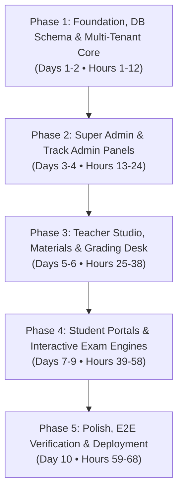

# Step-by-Step Implementation Roadmap & Timetable
## Dual-Track IELTS & SAT Educational Platform

## Goal Description
Build an end-to-end educational platform supporting two independent standardized testing tracks (**IELTS Prep** and **SAT Prep**), complete with independent entry portals/subdomains, a unified central management hub, and 4 dedicated panel tiers:
1. **Student Panel**: IELTS-only, SAT-only, and Dual (Both) student experiences with real-time exam engines.
2. **Teacher Panel**: Upload study materials (Audio, PDF, Video), question bank builder, and grading desk (IELTS band rubrics for Writing/Speaking, SAT Math/RW explanations).
3. **Track Admin Panel**: Independent administrative control for IELTS and SAT curricula, teachers, and student cohorts.
4. **Super Admin Panel**: Master platform oversight, RBAC permissions, cross-platform analytics, and billing/subscription controls.

---

## Master Development Timetable & Milestones

The roadmap is structured into **5 sequential phases** spanning **10 working days (68 focused engineering hours)**. Each phase has explicit start/end hour marks, deliverables, and quality verification gates.



### Detailed Schedule & Time-Table

| Phase & Day | Time Window (Hours) | Focus Area & Deliverables | Verification Gate |
| :--- | :--- | :--- | :--- |
| **Day 1** | **00:00 - 06:00** (Hrs 1–6) | **Project Foundation & Database Schema**<br>• Next.js App Router, Tailwind CSS, Lucide icons setup<br>• Prisma ORM schema (Users, Tracks, Enrollments, Materials, MockExams, Sections, Questions, Submissions, Grades)<br>• SQLite local setup with PostgreSQL migration compatibility | Prisma schema validates cleanly; `npx prisma db push` succeeds |
| **Day 2** | **06:00 - 12:00** (Hrs 7–12) | **Auth, RBAC & Multi-Tenant Routing**<br>• JWT session auth service & password hashing<br>• Multi-tenant middleware routing (`ielts.*`, `sat.*`, `hub.*` or `/ielts`, `/sat`, `/hub`)<br>• Database seeder with all 8 demo personas and sample mock exams | Seed runs successfully; all 8 test accounts can authenticate |
| **Day 3** | **12:00 - 18:00** (Hrs 13–18) | **Super Admin Master Control Panel**<br>• Super Admin Dashboard (`/super-admin`)<br>• Global KPI metrics (total students, IELTS vs SAT enrollment ratio, active teachers)<br>• User Management UI: Create, edit, assign roles (`STUDENT`, `TEACHER`, `TRACK_ADMIN`, `SUPER_ADMIN`) and track access (`IELTS`, `SAT`, `BOTH`) | Super Admin can promote/demote users and toggle track access |
| **Day 4** | **18:00 - 24:00** (Hrs 19–24) | **Track Admin Panels (IELTS & SAT)**<br>• IELTS Admin (`/admin/ielts`): manage IELTS teachers, student cohorts, mock test schedules<br>• SAT Admin (`/admin/sat`): manage SAT question releases, faculty assignments, score percentiles | Track admins isolated strictly to their respective domain |
| **Day 5** | **24:00 - 31:00** (Hrs 25–31) | **Teacher Panel: Material Upload & Course Studio**<br>• Study Material Manager (`/teacher/materials`): PDF guides, listening audio files, video lessons with track tagging<br>• Lesson & Course editor for both IELTS and SAT tracks | Teachers can upload materials and link them to track modules |
| **Day 6** | **31:00 - 38:00** (Hrs 32–38) | **Teacher Panel: Grading Queue & Test Builder**<br>• IELTS Writing/Speaking Grading Desk: 4-criteria band scoring rubric (Task Achievement, Coherence, Lexical, Grammar)<br>• SAT Review Desk: Question performance analytics and explanation tools<br>• Mock Test / Question Bank Builder | Teacher can evaluate an essay and submit graded band scores with comments |
| **Day 7** | **38:00 - 45:00** (Hrs 39–45) | **Central Hub & Student Dashboards**<br>• Central Switcher (`/hub`): Dual student dashboard, track switcher toggle, consolidated study streak<br>• IELTS Student Home (`/ielts/student`): 4-module dashboard, band target calculator<br>• SAT Student Home (`/sat/student`): 1600-point score target tracker, domain mastery charts | Seamless track switching without re-logging; correct module visibility |
| **Day 8** | **45:00 - 52:00** (Hrs 46–52) | **IELTS Interactive Exam Simulator**<br>• Listening Module: Custom audio player with speed controls, timed playback<br>• Reading Module: Split-screen passage & question form, text highlighter<br>• Writing Module: Real-time word counter (150 words for Task 1, 250 for Task 2)<br>• Speaking Module: In-browser audio recorder with prep timer & cue card display | Student can complete full 4-skill mock test and submit answers |
| **Day 9** | **52:00 - 58:00** (Hrs 53–58) | **Digital SAT Exam Simulator**<br>• Reading & Writing + Math timed module simulation<br>• Built-in scientific calculator drawer & math formula reference sheet<br>• Question strikethrough, bookmarking/flagging, and question navigator grid<br>• Automated 400–1600 scale scoring with detailed breakdown | SAT test runs timed, auto-scores Math/RW, and displays review screen |
| **Day 10**| **58:00 - 68:00** (Hrs 59–68) | **Polishing, Security Audit, Verification & Docs**<br>• Role and permission security validation across all endpoints<br>• Responsive mobile & tablet layout verification<br>• End-to-end user journey testing across all 8 personas<br>• Documentation, walkthrough artifact, and deployment guidelines | Complete test suite passes; production build succeeds cleanly |

---

## Detailed Step-by-Step Execution Plan

### Phase 1: Foundation & Multi-Tenant Core (Hours 1–12)

#### Hour 1–3: Project Initialization & UI Stack
- Initialize Next.js project with App Router, TypeScript, and Tailwind CSS.
- Configure path aliases (`@/*`), install `lucide-react`, `clsx`, `tailwind-merge`, and `@prisma/client`.
- Create global design system with distinct visual branding:
  - **IELTS Theme**: British academic styling (Deep Navy `#0F172A`, Crimson Accent `#DC2626`).
  - **SAT Theme**: Ivy-League collegiate styling (Slate `#1E293B`, Royal Indigo `#4338CA`, Gold `#D97706`).
  - **Hub / Admin Theme**: Modern dashboard clean enterprise styling (Neutral `#18181B`, Emerald `#059669`).

#### Hour 4–6: Prisma Database Schema
- [NEW] `prisma/schema.prisma`:
  - `User`: `id, email, passwordHash, name, role (STUDENT, TEACHER, TRACK_ADMIN, SUPER_ADMIN), trackAccess (IELTS, SAT, BOTH), createdAt`.
  - `Course` & `Lesson`: `id, title, description, track (IELTS, SAT), module, order, content`.
  - `StudyMaterial`: `id, title, description, fileUrl, fileType (PDF, AUDIO, VIDEO, DOC), track, uploadedById`.
  - `MockExam`: `id, title, track, examType, durationMinutes, totalScore, isPublished`.
  - `ExamSection`: `id, examId, sectionType (LISTENING, READING, WRITING, SPEAKING, SAT_RW, SAT_MATH), order, durationMinutes`.
  - `Question`: `id, sectionId, passageText, questionText, type, optionsJson, correctAnswer, explanation`.
  - `ExamSubmission`: `id, studentId, examId, status (IN_PROGRESS, SUBMITTED, GRADED), rawScore, scaledScore (Band 0-9.0 or SAT 400-1600), submittedAt`.
  - `SubmissionEvaluation`: `id, submissionId, teacherId, feedback, criteriaScoresJson, gradedAt`.

#### Hour 7–9: Auth Engine & Access Control
- [NEW] `src/lib/auth.ts`: JWT token signing, verification, password hashing with bcrypt, session extraction.
- [NEW] `src/lib/rbac.ts`: Fine-grained permission guards (`canAccessTrack(user, track)`, `isTeacher(user)`, `isAdmin(user)`).
- [NEW] `src/middleware.ts`: Subdomain and path-based routing interceptor:
  - Directs `ielts.*` or `/ielts/*` to IELTS-scoped views.
  - Directs `sat.*` or `/sat/*` to SAT-scoped views.
  - Directs `admin.*` or `/super-admin/*` to Super Admin views.
  - Enforces route authentication and track isolation.

#### Hour 10–12: Seeder & Demo Personas
- [NEW] `prisma/seed.ts`:
  - Super Admin: `superadmin@edu.com`
  - Track Admins: `ielts.admin@edu.com`, `sat.admin@edu.com`
  - Teachers: `ielts.teacher@edu.com`, `sat.teacher@edu.com`, `dual.teacher@edu.com`
  - Students: `ielts.student@edu.com`, `sat.student@edu.com`, `dual.student@edu.com`
  - Pre-seeded IELTS Mock Test (4 skills) and SAT Practice Test (RW + Math).

---

### Phase 2: Super Admin & Track Admin Panels (Hours 13–24)

#### Hour 13–15: Super Admin Global Dashboard
- [NEW] `src/app/(admin)/super-admin/page.tsx`:
  - Metric cards: Total Users, Active Students (IELTS vs SAT vs Dual), Total Teachers, Test Submissions, Revenue/Tier breakdown.
  - Quick action toolbar: Add User, Create Course, Broadcast Announcement, Export Reports.

#### Hour 16–18: User & Access Management
- [NEW] `src/app/(admin)/super-admin/users/page.tsx`:
  - Filterable, searchable data table of all users.
  - Role switcher modal: Change role (`STUDENT`, `TEACHER`, `TRACK_ADMIN`, `SUPER_ADMIN`).
  - Track access toggle: Grant `IELTS`, `SAT`, or `BOTH` with immediate access synchronization.

#### Hour 19–21: IELTS Track Admin Panel
- [NEW] `src/app/(ielts)/admin/page.tsx` & subroutes:
  - IELTS-specific KPIs: Average Listening/Reading band, Writing review backlog, Speaking examiner capacity.
  - Teacher roster for IELTS faculty.
  - IELTS Mock test scheduler and publication manager.

#### Hour 22–24: SAT Track Admin Panel
- [NEW] `src/app/(sat)/admin/page.tsx` & subroutes:
  - SAT-specific KPIs: Average 1600 composite score, Math vs RW score distributions, question difficulty index.
  - Question bank release approvals.
  - SAT student cohort manager.

---

### Phase 3: Teacher Studio & Grading Desk (Hours 25–38)

#### Hour 25–28: Study Material Upload Studio
- [NEW] `src/app/(teacher)/teacher/materials/page.tsx`:
  - Multi-file uploader with drag-and-drop.
  - Metadata tagging: Track selection (`IELTS` or `SAT`), Skill/Domain (`Listening`, `Reading`, `Writing`, `Speaking`, `Algebra`, `Advanced Math`, `Grammar`), target level.
  - Material library browser with preview for PDF, audio player for MP3, and video links.

#### Hour 29–33: IELTS Writing & Speaking Grading Desk
- [NEW] `src/app/(teacher)/teacher/grading/ielts/page.tsx`:
  - Pending submissions queue (essays and audio recordings).
  - Essay grading interface: Split screen with student essay on left, interactive band scoring rubric on right:
    - Task Achievement / Response (0-9)
    - Coherence and Cohesion (0-9)
    - Lexical Resource (0-9)
    - Grammatical Range and Accuracy (0-9)
  - Calculated overall Band Score with teacher written feedback and inline annotations.
  - Speaking grading interface: Integrated audio playback player with waveform and pronunciation/fluency rubric.

#### Hour 34–38: Test Builder & Question Studio
- [NEW] `src/app/(teacher)/teacher/test-builder/page.tsx`:
  - Question authoring tool supporting:
    - Multiple choice with detailed explanations.
    - Passage-based reading sets.
    - IELTS fill-in-the-blank / summary completion.
    - SAT Math grid-in / student-produced response.

---

### Phase 4: Student Portals & Interactive Exam Engines (Hours 39–58)

#### Hour 39–42: Central Hub & Dual Student Switcher
- [NEW] `src/app/(hub)/hub/page.tsx`:
  - Unified student dashboard for dual students.
  - Side-by-side snapshot: IELTS Target Band vs Current, SAT Target Score vs Current.
  - Quick-switch buttons launching directly into the dedicated IELTS or SAT portals.
  - Study calendar consolidating upcoming assignments and mock exams from both tracks.

#### Hour 43–47: IELTS Student Experience & Modules
- [NEW] `src/app/(ielts)/student/page.tsx`:
  - 4 Module cards: Listening, Reading, Writing, Speaking.
  - Study materials repository filtered by module.
- [NEW] `src/app/(ielts)/student/exam/[id]/page.tsx`:
  - **Listening Engine**: Synchronized audio playback with auto-advancing question sections.
  - **Reading Engine**: Dual-pane layout (passage with resizable split, selectable text highlighter, question form).
  - **Writing Engine**: Timed writing prompt with live word counter and autosave.
  - **Speaking Engine**: Cue card presenter with 1-minute prep timer, 2-minute record timer, and microphone capture via Web Audio API.

#### Hour 48–53: Digital SAT Student Experience & Exam Simulator
- [NEW] `src/app/(sat)/student/page.tsx`:
  - SAT preparation home with domain mastery (Algebra, Geometry, Craft & Structure).
- [NEW] `src/app/(sat)/student/exam/[id]/page.tsx`:
  - Replicates modern Digital SAT testing software:
    - Timed sections (Reading & Writing 32 min, Math 35 min).
    - Header with remaining time countdown, hide/show clock toggle.
    - Built-in on-screen scientific calculator modal.
    - Math reference sheet modal (geometry formulas, special right triangles).
    - Question tools: Strikethrough answer options, bookmark/flag for review.
    - Question navigation grid showing answered, flagged, and unanswered items.

#### Hour 54–58: Score Reports & Analytics
- [NEW] `src/app/(ielts)/student/results/[submissionId]/page.tsx`:
  - IELTS Band score breakdown (Overall + individual L, R, W, S scores), teacher remarks, answer explanations.
- [NEW] `src/app/(sat)/student/results/[submissionId]/page.tsx`:
  - SAT score report (400-1600 composite, 200-800 RW, 200-800 Math), percentile benchmark, question-by-question review.

---

### Phase 5: Verification, Polish & Deployment Readiness (Hours 59–68)

#### Hour 59–62: Security & RBAC Enforcement Verification
- Verify that an IELTS-only student cannot view SAT mock exams or access `/sat/*`.
- Verify that an SAT-only student cannot view IELTS mock exams or access `/ielts/*`.
- Verify that an IELTS teacher cannot grade SAT submissions or edit SAT curriculum.
- Verify that Super Admin retains unrestricted access across all routes.

#### Hour 63–65: UI/UX Responsiveness & Mobile Tuning
- Optimize student dashboards, audio players, and grading desks for desktop, tablet, and mobile devices.
- Verify dark/light theme consistency across portals.

#### Hour 66–68: Final Automated Build, Walkthrough & Handover
- Execute complete production build: `npm run build`.
- Generate comprehensive seed verification test report.
- Deliver walkthrough artifact documenting test accounts, routes, and admin instructions.

---

## Verification Plan

### Automated Verification
```bash
# 1. Database schema migration & synchronization
npx prisma generate
npx prisma db push

# 2. Database seeding with all 8 demo personas & tests
npx tsx prisma/seed.ts

# 3. Next.js production type-checking and build
npm run build
```

### Manual Verification Checklist Across All 4 Panels

| Persona / Account | Panel to Test | Expected Verification Result |
| :--- | :--- | :--- |
| `superadmin@edu.com` | `/super-admin` | Full visibility over both IELTS & SAT, user permission editor, cross-track metrics |
| `ielts.admin@edu.com` | `/admin/ielts` | Manages IELTS faculty and courses; access to `/sat/*` is denied or redirected |
| `sat.admin@edu.com` | `/admin/sat` | Manages SAT curriculum and question releases; access to `/ielts/*` is denied |
| `ielts.teacher@edu.com` | `/teacher` | Can upload IELTS audio/PDFs, grade IELTS essays with rubrics; SAT materials locked |
| `sat.teacher@edu.com` | `/teacher` | Can upload SAT materials, view SAT student performance; IELTS materials locked |
| `dual.teacher@edu.com` | `/teacher` | Can seamlessly switch between IELTS and SAT classes and materials |
| `ielts.student@edu.com` | `/ielts/student` | Accesses all 4 IELTS modules and mock exams; SAT portal shows upgrade prompt |
| `sat.student@edu.com` | `/sat/student` | Accesses Digital SAT exam simulator (with calculator); IELTS portal locked |
| `dual.student@edu.com` | `/hub` | Central dashboard displays both IELTS and SAT; one-click toggle between exams |
